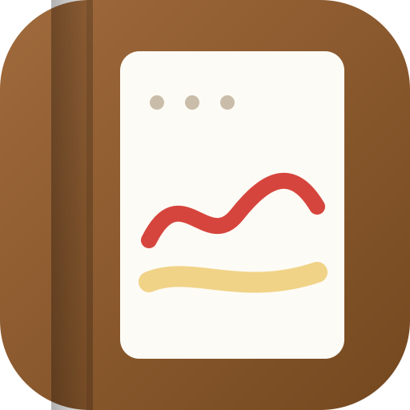

<div align="center">



# OpenNotes

**Free, open-source handwritten notes for iPad, Mac & Windows.**

Pressure-sensitive ink · text boxes · shape snap · lasso · images · PDF import & annotation
Private by design — your notes never leave your device.

[](./LICENSE)
[](.github/workflows/ci.yml)
[](./CONTRIBUTING.md)
[](#install-on-your-device)

</div>

---

## What is OpenNotes?

OpenNotes is an installable Progressive Web App (PWA) that brings the
paper-notebook experience to every screen you own — one codebase, three
platforms. Open it in Safari on your iPad, install it from the browser on
your Mac or Windows PC, and write with a stylus, finger, trackpad or mouse.

There is **no account, no cloud and no tracking**. Notebooks are stored
locally in your browser's IndexedDB and render entirely on-device, so the
app keeps working at 30,000 feet with the Wi-Fi off.

## Features

### ✍️ Handwriting kit
- **Pressure-sensitive vector ink** — real stylus pressure (Apple Pencil, S Pen, Wacom) drives stroke width; mouse and finger input get velocity-simulated pressure so every stroke looks natural
- **Pen** with 8-ink palette and 5 width presets
- **Highlighter** with translucent inks that never muddy overlapping strokes
- **Shape snap** — draw a rough line, triangle, rectangle or ellipse and watch it snap to the perfect form
- **Precise eraser** — rubs out exactly what you touch, splitting strokes
- **Stroke eraser** — removes whole strokes, like a real pencil eraser
- **Laser pointer** — a fading trail for presenting and teaching, never saved to the page
- **Palm rejection** — rest your hand on the screen while writing with a stylus
- **Pencil hover preview** (iPadOS 17+) shows the stroke width before you commit

### 🔤 Text, images & selection
- **Text boxes** — tap anywhere to type, drag to reposition, wrap-width aware rendering that matches the canvas exactly
- **Images** — insert photos & screenshots, drag to move, corner-drag to resize
- **Lasso select** — circle any mix of ink, text and images, then move, duplicate or delete them together

### 📄 PDF annotation
- **Import any PDF** — every page becomes a fixed sheet rendered locally via pdf.js, ready for ink, text and images
- Nothing is uploaded: pages are rasterized in your browser and stored in IndexedDB

### 🧭 A workspace that behaves like an app
- Notebook library with leather-style covers, search, rename, recolor & duplicate
- Paper templates: blank, lined, grid and dotted
- Page overview grid with jump-to-page and per-page bookmarks
- Pinch-zoom & pan (two fingers), trackpad scroll, `Ctrl/⌘ + wheel` zoom
- Infinite undo/redo with element-level history (`⌘/Ctrl + Z` / `⇧Z`)
- Keyboard shortcuts: `P` pen · `H` highlighter · `E` eraser · `S` stroke eraser · `R` shape · `T` text · `V` lasso · `I` image · `L` laser · `←`/`→` pages · `Delete` selection

### 📦 Own your data
- **Local-first storage** — IndexedDB, autosaved as you write
- **Export a page as PNG** or a whole notebook (PDF pages included) as PDF
- Uninstall the app and your browser data remains yours to back up

## Install on your device

| Platform | How to install | Ink input |
|----------|----------------|-----------|
| **iPad** | Open the site in Safari → Share → **Add to Home Screen** | Apple Pencil (pressure + hover), finger |
| **macOS** | Open in Chrome/Edge → address-bar **Install** icon, or Safari → File → Add to Dock | Trackpad, mouse, drawing tablets |
| **Windows** | Open in Chrome/Edge → address-bar **Install** icon | Pen/touch screens, mouse |

> Any modern browser works without installing — installing just adds an
> app icon, its own window and offline launch.

## Run it locally

```bash
git clone https://github.com/<your-org>/opennotes.git
cd opennotes
bun install        # or: npm install / pnpm install
bun run dev        # or: npm run dev
```

Open http://localhost:3000. That's it — no database server, no environment
variables, no API keys.

### Tech stack

| Layer | Choice | Why |
|-------|--------|-----|
| Framework | [Next.js](https://nextjs.org) (App Router) + TypeScript | One deployable for every platform via PWA |
| Ink engine | Custom canvas engine on [perfect-freehand](https://github.com/steveruizok/perfect-freehand) | Pressure-shaped variable-width outlines, tiny and fast |
| State | [Zustand](https://zustand.docs.pmnd.rs) | Minimal global state without boilerplate |
| Persistence | IndexedDB (no ORM, no server) | Data stays on the device, works offline |
| UI | [Tailwind CSS](https://tailwindcss.com) + [shadcn/ui](https://ui.shadcn.com) + [lucide-react](https://lucide.dev) | Warm, paper-inspired interface |
| PDF export | [jspdf](https://github.com/parallax/jsPDF) | Client-side, zero backend |
| PDF import | [pdf.js (pdfjs-dist)](https://github.com/mozilla/pdf.js) | Local page rasterization, lazily loaded |

### Project structure

```
src/
├── app/                      # App Router: single-page shell + metadata
├── components/opennotes/
│   ├── ink-engine.ts         # Canvas input + rendering engine
│   ├── editor.tsx            # Notebook editor (pages, autosave, export, text overlay)
│   ├── toolbar.tsx           # Floating tool rail
│   ├── library.tsx           # Notebook library grid + PDF import
│   └── logo.tsx              # Brand + notebook covers
└── lib/opennotes/
    ├── types.ts              # Data model (strokes, text, images, pages, notebooks)
    ├── ink.ts                # Stroke geometry, hit-testing, erasing, shape recognition
    ├── render.ts             # Shared page renderer (canvas, exports, thumbnails)
    ├── pdf-import.ts         # pdf.js pipeline → annotatable page backgrounds
    ├── paper.ts              # Paper template painter
    ├── db.ts                 # IndexedDB wrapper
    ├── store.ts              # Zustand store + welcome seed
    └── export.ts             # PNG / PDF export pipelines
```

## Contributing

Contributions are very welcome — handwriting OCR, cloud sync adapters,
audio notes… start with [CONTRIBUTING.md](./CONTRIBUTING.md)
and pick something from the [roadmap](./ROADMAP.md).

```bash
bun run lint       # ESLint
bun run build      # production build check
```

## Roadmap

See [ROADMAP.md](./ROADMAP.md) for the full plan — highlights:

- [x] Text boxes & shapes with snap-to-perfect-form
- [x] PDF/image import and annotation
- [x] Lasso selection, duplication & mixed-element move
- [ ] Notebook folders & tags
- [ ] Optional end-to-end encrypted sync (BYO storage)

## Acknowledgements

- [perfect-freehand](https://github.com/steveruizok/perfect-freehand) — stroke outline generation
- [pdf.js](https://github.com/mozilla/pdf.js) — local PDF rendering
- [jsPDF](https://github.com/parallax/jsPDF) — client-side PDF export
- [shadcn/ui](https://ui.shadcn.com) & [Radix UI](https://www.radix-ui.com) — accessible primitives
- [GoodNotes](https://www.goodnotes.com) — the app that inspired this project (OpenNotes is not affiliated)

## License

[MIT](./LICENSE) — free to use, study, fork and ship.
